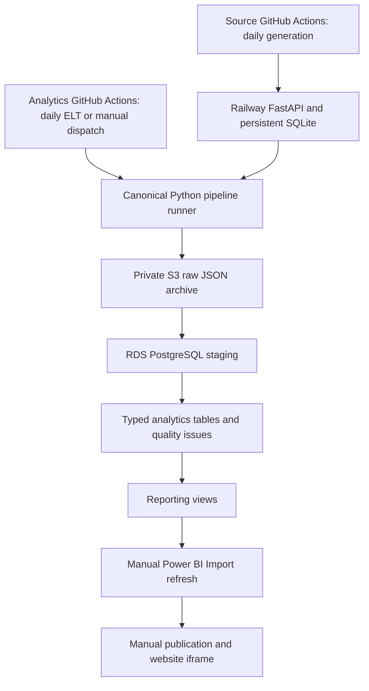

# Guitar Lessons Marketing Analytics — Architecture

This portfolio project turns intentionally messy synthetic marketing and
subscription data into PostgreSQL analytics models and a Power BI report.
GitHub Actions automates Python extraction and loading, a replayable S3 raw
archive, typed SQL transformations, data-quality checks, and reporting-view
validation.

## 1. Implemented architecture



The source API lives in a separate repository. This analytics repository owns
API-to-S3 extraction, validated S3-to-PostgreSQL loading, analytics and
reporting SQL, and recurring orchestration.

The pipeline archives complete API pages in S3, then rediscovers and validates
that exact run before allowing staging writes. Each delivery remains
inspectable and replayable.

## 2. Source service

The Railway service uses FastAPI with SQLite on a persistent volume. GitHub
Actions calls its token-protected generation endpoint daily at 06:17 UTC.
Generation is deterministic, backfills missed dates, and is idempotent for
each business date.

The analytics repository uses only the public read endpoints:

- `GET /health`;
- `GET /status`;
- `GET /tables`;
- `GET /tables/{table_name}/raw?since=<cursor>`.

The API response provides integer `since` and `next_since` cursors. These are
separate from `_raw_row_id`, which identifies a delivered source row and is
stored as text in staging.

## 3. Raw S3 archive

Historical and incremental pages use the same versioned object contract:

```text
raw/<load_type>/<table_name>/
  extract_date=YYYY-MM-DD/
  run_id=YYYYMMDDTHHMMSSffffffZ/
  page-NNNNN.json
```

The private bucket blocks public access and uses SSE-S3 encryption. Each JSON
object retains page metadata plus the complete API response. A selected run is
validated for table identity, wrapper shape, allowed JSON types, page order,
and cursor continuity before database loading.

## 4. PostgreSQL schemas

One encrypted RDS PostgreSQL instance contains three schemas:

| Schema | Implemented responsibility |
|---|---|
| `staging` | Source-shaped text values, raw lineage, object manifests, and API watermarks |
| `analytics` | Typed deduplicated dimensions/facts and source quality issues |
| `reporting` | Stable dashboard-facing metric views and additive components |

Connections use `verify-full` TLS with an Amazon RDS CA bundle. Automated
runs obtain database settings from AWS Secrets Manager and use temporary AWS
credentials through GitHub OIDC. Local commands read their configuration from
the ignored `.env` file.

### Staging layer

Seven staging tables preserve intentional source defects rather than hiding
them during ingestion. Each row retains its S3 key, run ID, load type, page,
cursor range, extraction time, and load time.

Each S3 page is applied in one transaction. The loader claims the object,
inserts duplicate-safe rows, and advances the table watermark together. On
failure, all three actions roll back. Replaying an already loaded object skips
it without changing rows or cursors.

### Analytics layer

The implemented analytics layer contains:

- `analytics.dim_plan`;
- `analytics.dim_campaign`;
- `analytics.dim_customer`;
- `analytics.fact_subscription_period`;
- `analytics.fact_payment`;
- `analytics.fact_campaign_daily`;
- `analytics.fact_campaign_assignment`;
- `analytics.data_quality_issue`.

Versioned SQL applies guarded type conversions, whitespace and case
normalization, deterministic `ROW_NUMBER()` deduplication, correction-aware
selection, foreign keys, checks, and indexes. A synthetic campaign with ID
`-1` preserves assignments containing the controlled unmatched campaign ID.
Invalid values, exact duplicates, superseded deliveries, blanks, missing
values, and unknown references remain measurable in the quality table.

Upserts change rows only when selected lineage or typed values differ. The
production runner validates staging, manifest, watermark, and lineage
invariants before commit. It can then rerun the transformation and fingerprint
every persisted value, including audit timestamps, to prove unchanged-input
invariance. Recurring production checks use invariants that remain valid as
the dataset grows.

### Reporting layer

Seven reusable `analytics` helper views establish the lowest useful grains for
the shared reporting cutoff, paid cohorts, monthly subscription state,
customer-month contribution, CLV checkpoints, payment-recovery episodes, and
campaign-assignment outcomes. Eleven `reporting` views then expose stable
dashboard grains for movement, retention, recovery, value, CLV, campaign
delivery, experiment arms, incremental impact, and data quality.

The reporting views retain additive numerators and denominators so rates,
lift, ROAS, ROI, and other non-additive results can be recomputed for the
selected dashboard context. Campaign spend and assignment outcomes are each
reduced to a compatible campaign/window grain before joining. The guarded
production runner derives the current reporting cutoff, validates durable
component relationships before commit, and reapplies all 18 views to prove
unchanged SQL is replaceable.

### Recurring orchestration

`.github/workflows/daily-elt.yml` schedules the pipeline at 07:17 UTC
(`17 7 * * *`), leaving one hour after upstream generation. The repositories
have independent schedules. GitHub Actions may start a scheduled run later;
committed per-table watermarks determine which source rows are extracted.
`workflow_dispatch` invokes the same entry point for recovery or verification:

```bash
python -m extract_load.run_daily_pipeline --apply
```

The workflow installs dependencies under Python 3.12 and runs
`python -m pytest -q`. It then assumes an AWS role through OIDC, retrieves RDS
settings from Secrets Manager, downloads the official CA bundle, and grants
the runner's public IPv4 `/32` temporary access to PostgreSQL on port 5432.
A bounded TCP readiness check makes up to 12 attempts before ELT begins.
The cleanup step removes the temporary ingress rule after success or failure.

The runner holds a PostgreSQL session-level advisory lock across these stages:

1. Read the seven committed source-table watermarks.
2. Extract later API rows and archive nonempty pages under one UTC S3 run ID.
3. Rediscover and validate that run's tables, pages, and cursor ranges.
4. Load pages into staging using transactional manifests and watermarks.
5. Replay the exact run and require zero newly loaded pages; reconcile final
   watermarks and staging lineage.
6. Apply and validate the analytics transformation, including an unchanged-input
   rerun check.
7. Apply and validate all 18 analytics-helper and reporting views, including
   a repeated application of unchanged SQL.
8. Write a GitHub Actions summary with source rows, archived and loaded pages,
   analytics rows, quality issues, and the reporting cutoff date.

GitHub Actions concurrency uses `cancel-in-progress: false`; the database lock
also rejects overlapping canonical runs started outside GitHub Actions.
A failed stage stops downstream execution. Page commits preserve durable
progress; a recovery run reads committed watermarks to process remaining rows.
The incremental-load utility can also resume a specific archived run using
its extraction date, run ID, and page-count contract.

Running the daily module without `--apply` performs read-only API and
PostgreSQL readiness checks. Configuration and recovery instructions are in
[Daily ELT automation](docs/daily_elt_automation.md).

## 5. Repository structure

```text
guitar-lessons-marketing-analytics/
├── README.md
├── ARCHITECTURE.md
├── .github/workflows/daily-elt.yml
├── extract_load/
│   ├── config.py
│   ├── extract.py
│   ├── s3_writer.py
│   ├── s3_reader.py
│   ├── staging_rows.py
│   ├── postgres_loader.py
│   ├── watermarks.py
│   ├── pipeline_validation.py
│   ├── run_initial_load.py
│   ├── run_historical_staging_load.py
│   ├── run_incremental_load.py
│   ├── run_analytics_transform.py
│   ├── run_reporting_views.py
│   ├── run_daily_pipeline.py
│   └── run_bi_access.py
├── sql/
│   ├── schema/
│   │   ├── 001_create_schemas.sql
│   │   ├── 002_create_staging_tables.sql
│   │   └── 003_create_etl_control.sql
│   ├── staging_to_analytics/
│   │   ├── 001_create_analytics_tables.sql
│   │   └── 002_transform_staging_to_analytics.sql
│   ├── analytics_views/
│   │   └── 001_create_reporting_helper_views.sql
│   ├── reporting_views/
│   │   └── 001_create_reporting_views.sql
│   └── bi_access/
│       └── 001_create_bi_reader_role.sql
├── docs/
│   ├── data_dictionary.md
│   ├── analytics_cleaning_contract.md
│   ├── metric_definitions.md
│   ├── dashboard_platform_decision.md
│   ├── daily_elt_automation.md
│   └── power_bi_semantic_model.md
├── tests/
│   └── integration/
├── dashboard/screenshots/
│   ├── FullModelView.png
│   ├── ModelLeftToRight_Part1.png
│   ├── ModelLeftToRight_Part2.png
│   ├── ModelLeftToRight_Part3.png
│   ├── PowerBIModelValidationSummary.png
│   └── PowerBIIncrementalityValidation.png
└── infra/
```

## 6. Validation and recovery

Recurring checks validate the current dataset rather than fixed row counts:

- The API advertises exactly the seven supported source tables.
- Staging raw-row identifiers are unique and retain loaded-object lineage.
- Manifest totals cover retained staging rows, and committed watermarks match
  the greatest loaded cursors.
- The archived run matches its extraction contract, including zero-page tables.
- Exact-run replay changes no staging rows, manifests, or watermarks.
- Analytics counts do not decrease, and analytics and quality rows retain valid
  staging lineage.
- Reporting components reconcile: retained customers do not exceed eligible
  customers, recovered episodes do not exceed failed episodes, and finalized
  experiment windows do not exceed all windows.
- Reporting quality counts match analytics quality counts.
- Unchanged inputs preserve analytics values and reporting view definitions.

Each staging page commits independently. Analytics transformations and
reporting-view application use their own transaction boundaries; the daily
pipeline is not one transaction spanning all layers. After correcting a
failure, **Run workflow** executes the canonical pipeline again using durable
committed progress.

## 7. Power BI delivery

Power BI Desktop connects to approved dimensions and reporting views through
verified TLS and a least-privilege BI login. The versioned
`marketing_analytics_bi_reader` `NOLOGIN` role grants access to an explicit
allowlist; the operational login inherits that role and defaults to read-only
transactions. It cannot read staging or persist source changes.

The semantic model uses Import mode, shared dimensions, explicit relationships,
a marked Date table, a paid-tenure dimension, and DAX measures. Power Query
performs presentation and type adjustments; SQL defines the reusable reporting
metrics. The model contract is documented in
[Power BI semantic model](docs/power_bi_semantic_model.md).

A manual Desktop refresh re-queries the report-facing SQL views. The report is
published to the Power BI service and embedded on the portfolio website using
Publish to web. The public report displays the published Import snapshot.
Database ELT runs update S3 and PostgreSQL; Power BI refresh and republication
are separate manual operations. The service publication uses no scheduled
refresh, gateway, service-side PostgreSQL credentials, or DirectQuery.

## 8. Reporting design rules

- Paid churn includes cancellation and paid-to-Free movement.
- Pro-to-Master and Master-to-Pro movements are upgrades or downgrades, not
  paid-logo churn.
- CLV uses contribution value rather than revenue alone; CAC remains separate.
- Campaign lift follows intention-to-treat assignment, including holdouts.
- Campaign facts and customer/payment facts must be aggregated to compatible
  grains before joining to avoid row multiplication.
- Dashboard queries read stable `reporting` views rather than reproducing
  metric definitions in the visualization layer.
